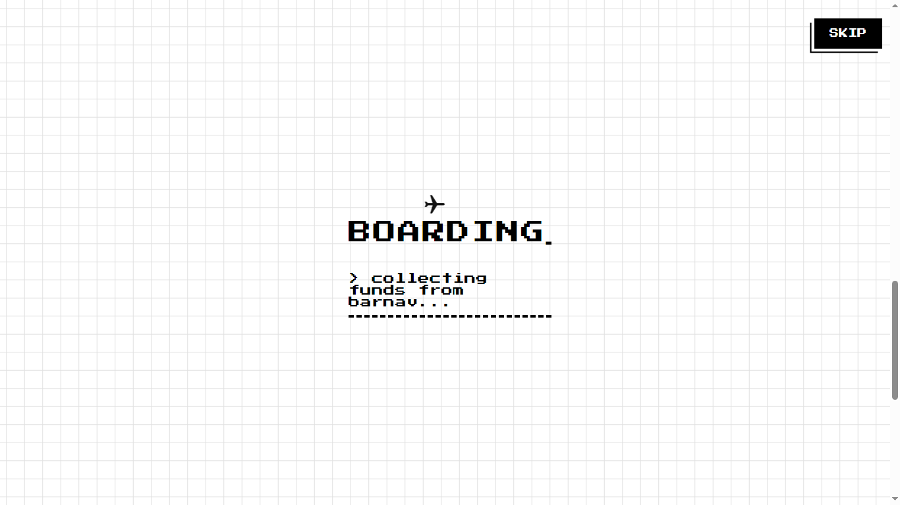
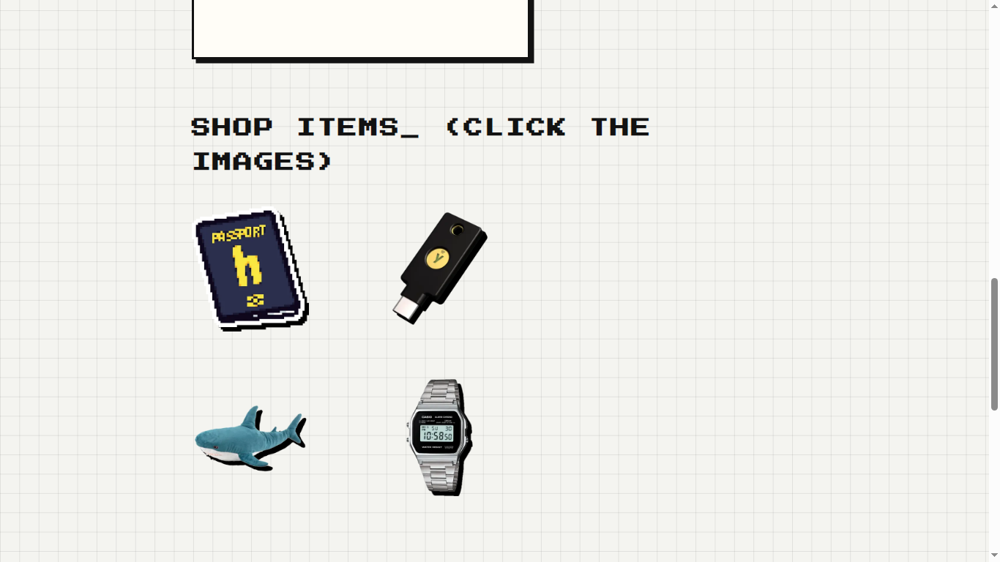

# Hackclub-Embassy-Site-Fan-made 
A Fan made websitr for the hackclub Embassy YSWS, built with retro pixel and grid paper asthetic using plain Html,CSS and JavaScript.

> Note- The E-mail filling form does not work also it should not work. The website might have bugs and the timer only counts till 7th december 11:59 soo its limited and on a purpose.

## Features (the are prob good)

- **Boarding Screen**  An Animated loading screen wit a custom boot log and a skip button.
- **Deadline Counter** A live timer counting down to the december 7th submission date deadline.
- **Stamp Calculator** Calculates earned stamps based on logged building hours (10 stamps per hour ).
- **Interactive Shop** Clickable Stickers (Hackclub Passport,YubiKey, Blahaj, and a Casio F-91 and much more in actual Shop) that Open a draggable modal with item details.
- **FAQ Section** Expandable accordion covering Hackatime tracking ,project eligiblity, and deadline  

## Screenshots 

## How to Run It 

This shit has zero dependencies btw and no build steps, u dont need a Nvidia Blackwell 6000 GPU to run this.

1. Clone or Download this Repo. 
2. Keep the sticker PNGs. 
3. Open 'index.html' in ur browser and ur good to go.

# Tech Stack & What I learned 

- **HTML & CSS:** Used a grid-paper background, `Press Start 2P` pixel font, and chunky thick shadows to give it a notebook/passport feel.

- **Vanila JavaScript:** this Powers the whole loading boot sequence (ofc the boot is fake ), the live countdown timer to deadline  (NO ONE WILL SAY COPY OF 3AM), the stamp calculator, and the draggable shop thing (<dialog> modal).

Making the draggable modal math work (and snapping its back to the default place when closed ) was kinda tricky at first, but it taught me a lot about how mouse events and positioning actually work in JS.

## Credits 

- **Website** ofc its me (K8BH) made with love btw ❤️.
- **Embassy YSWS** Cloud,Barnav,DSG,Riiitam.
- **Font** [Press Start 2P](https://fonts.google.com/specimen/Press+Start+2P) from Google Fonts